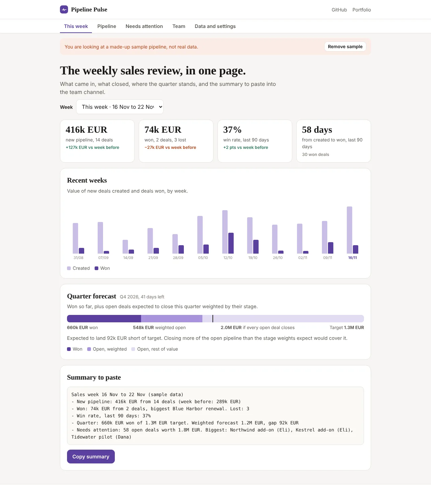

# Pipeline Pulse

**Upload a CRM export and get the weekly sales review: new pipeline, wins, forecast against target, deals that need attention, and a summary to paste.**

**Current version:** 0.1.0

Live app: https://kostasxeras.com/pipeline-pulse/



## Why this exists

Every sales team has a weekly review, and someone spends an hour before it pulling numbers out of the CRM into a spreadsheet. The CRM has the data but not the view: what came in this week, what closed, where the quarter will land, and which deals are going quiet. Most teams cannot add a BI tool for this, and a spreadsheet breaks every time the export changes.

## Who it is for

- Sales managers and team leads who run a weekly pipeline review
- Revenue operations and founders who sell, without a BI tool
- Product managers who need a quick read on pipeline health

## What it does

- **Import:** drop any CRM deals export as CSV. Commas, semicolons and tabs, European number formats and day-first or month-first dates are handled. Column names are matched automatically, and you can fix the matching with a preview before importing.
- **This week:** new pipeline, won and lost, 90-day win rate and days from created to won, each against the week before. A 12-week chart of created and won value.
- **Quarter forecast:** won so far, plus open deals expected to close this quarter weighted by stage, against your target, with a plain sentence on the gap.
- **Summary to paste:** the week in six lines, ready for the team channel.
- **Pipeline:** open value by stage with editable stage weights, expected close by month with overdue deals flagged, and win rate by source.
- **Needs attention:** open deals with no activity for a set number of days or a close date in the past, biggest first, filterable by owner.
- **Team:** open and weighted pipeline, wins this quarter, win rate and alerts per owner.
- **Sample data:** a made-up pipeline of 260 deals, clearly marked, to try it without a file.

## Privacy

Your file is read in the browser and stored in its local storage. There is no account and no server of mine. Nothing is sent anywhere. Clearing your browser data deletes it.

## Decisions

- [Start from a CSV export, not a CRM integration](docs/decisions/0001-csv-not-crm-integration.md)
- [Forecast with stage weights the user can change](docs/decisions/0002-weighted-forecast-with-editable-weights.md)
- [Keep the pipeline in the browser](docs/decisions/0003-data-stays-in-the-browser.md)

## How I would measure success

No usage data yet. These are the measures I would track, with targets to set after a first month of use.

| Measure | Definition | Target |
|---|---|---|
| Time saved | Minutes spent preparing the weekly review, before and after | [x] min |
| Weekly use | Share of weeks with at least one import | [x]% |
| Forecast accuracy | Weighted forecast at week 6 against the quarter's actual result | [x]% |

## What I would do next

1. A direct HubSpot or Salesforce import
2. Stage weights learned from the team's own history
3. Week-over-week change per deal: what moved stage, what slipped

## My role

I defined the problem, the users, the features and the decisions. The idea started from an example in Justin McKelvey's list of project ideas, which I turned into a full app with my own product choices. Screenshots use the app's made-up sample data.

## Run it yourself

One HTML page and one stylesheet, with no build step. Open `index.html` through any local web server, for example `python3 -m http.server`, then go to http://localhost:8000.

## Repo layout

```
index.html               The app
app.css                  Shared base styles
docs/product-brief.md    Problem, users, goals, scope
docs/case-study.md       Approach, decisions, what to measure, next steps
docs/decisions/          One record per real tradeoff
docs/screenshots/        Desktop and mobile
```
